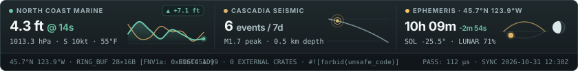

<kbd>PNWcoastie</kbd> <kbd>JadedRose</kbd> <kbd>#![forbid(unsafe_code)]</kbd>

I like building practical, reliable, low-footprint software and figuring out how complex systems behave under the hood—both at the silicon/OS boundary and inside frontier reasoning harnesses. Most of what you'll find here are tools, architectures, and stress-tests I built to answer my own questions: secure systems programming in Rust, security forensics, and deep-dive agentic orchestration. Always learning, usually tinkering, and happiest when a system is deterministic, fits comfortably in CPU cache, and holds up when pushed to its limits.

- **Usual workbench:** Secure-by-construction Rust (`#![forbid(unsafe_code)]`), lock-free SPSC sidecars, clean-room security forensics, and Google Antigravity / the Google ecosystem.
- **Agentic & model forensics:** Tearing down frontier model and harness architectures—comparative behavioral mechanics, security & context boundaries, and adversarial Maker–Checker orchestration pushed well past standard workflows.
- **Current rabbit holes:** Chain-of-Thought (CoT) reasoning dynamics & recursive self-improvement (Dream / RSI) loops, sub-microsecond market microstructure, orthogonal volume/event clocks, stochastic control & thermodynamic math, and autonomous flight / SITL telemetry.

```diff
+ Secure-by-construction state, L1/L2 cache-aligned memory, and clean-room security forensics
+ Adversarial Maker–Checker harnesses and empirical frontier-model stress testing
+ Dissect how systems break; engineer them so entire classes of hazards cannot exist
- Unbounded heap allocations, mutex contention, network I/O on the hot path, or unverified black boxes
```

<details>
<summary><kbd>▸ SYSTEM_MANIFEST.toml</kbd></summary>

```toml
[profile]
alias         = "JadedRose / PNWcoastie"
region        = "Pacific Northwest (45.7°N, 123.9°W)"
workbench     = ["rust-forbid-unsafe", "spsc-sidecars", "security-forensics", "google-antigravity"]
focus         = [
  "secure-systems-programming",
  "security-forensics",
  "agent-harness-architecture",
  "frontier-model-evaluation",
  "market-microstructure",
  "stochastic-thermodynamics",
  "autonomous-flight-sitl",
]

[constraints]
footprint     = "cache-resident (L1d / L2)"
hot_path      = "zero-alloc, lock-free SPSC, no network I/O"
orchestration = "adversarial maker-checker harnesses, CoT & Dream/RSI behavioral forensics"
adage         = "Dissect how systems break in the wild; engineer them so entire classes of failure cannot exist by construction."
philosophy    = "Keep the footprint tiny, isolate the hot path, stress-test the reasoning boundary, and build things that hold up in the real world."
```

</details>

<picture>
  <source media="(prefers-color-scheme: dark)" srcset="assets/telemetry-dark.svg">
  <source media="(prefers-color-scheme: light)" srcset="assets/telemetry-light.svg">
  
</picture>

---
<sub>🌲 Pacific Northwest · Feel free to explore the repositories and architecture case studies below.</sub>
