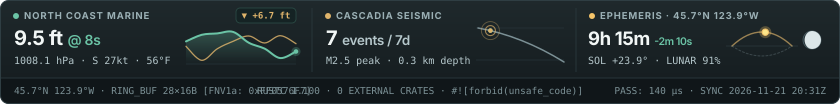

<kbd>PNWcoastie</kbd> <kbd>JadedRose</kbd> <kbd>#![forbid(unsafe_code)]</kbd>

I build practical, reliable, low-footprint software and spend a lot of time figuring out how complex systems actually behave under the hood, both at the OS/binary level and inside frontier AI harnesses. Most of what you will find here are tools, apps, simulations, and stress-tests built to solve real problems or answer hard technical questions. Always learning, usually tinkering, and happiest when a system is deterministic, lean, and holds up when pushed to its limits.

- **Core stack:** Safe Rust (`#![forbid(unsafe_code)]`), WebAssembly, TypeScript, Astro, Flutter Web, Python, Cloudflare Workers, Firebase, and Linux systems tooling.
- **What I build:** Deterministic simulation and replay engines, full-stack web apps and internal operations portals, low-footprint Discord/community automation, clean-room binary/security forensics, and adversarial AI agent harnesses.
- **Current rabbit holes:** Autonomous 3D FPV/combined-arms simulation (`Rust + WASM + Three.js`), real-time telemetry and market microstructure, and frontier model reasoning boundaries.

### Open for Consulting & Custom Builds

I am available for **fixed-scope milestones, custom software builds, and technical consulting**, including:
- **Systems Rust & WebAssembly:** Deterministic simulation/replay cores, performance-critical backends, and verified legacy-to-Rust ports.
- **Full-Stack Web & Community Tools:** Role-gated team portals, dashboards, interactive web apps, and reliable low-footprint bots or deployment pipelines.
- **Security Forensics & AI Workflows:** Binary/dependency auditing, compiler guardrails, and custom agentic evaluation harnesses.

Want to talk through a project or custom setup? **[Start a GitHub Discussion](https://github.com/PNWcoastie/PNWcoastie/discussions)** or email **[jadedmatted@gmail.com](mailto:jadedmatted@gmail.com)**.

<details>
<summary><kbd>▸ SYSTEM_MANIFEST.toml</kbd></summary>

```toml
[profile]
alias     = "JadedRose / PNWcoastie"
region    = "Pacific Northwest (45.7°N, 123.9°W)"
workbench = ["rust-forbid-unsafe", "wasm", "typescript", "flutter-web", "security-forensics", "google-antigravity"]
contact   = "jadedmatted@gmail.com"
status    = "open-for-custom-builds-and-milestones"

[principles]
footprint = "lean and predictable"
hot_path  = "zero-alloc, lock-free where it counts, no black boxes"
approach  = "See how systems break in the wild, then design them so whole classes of failure cannot compile."
```

</details>

<picture>
  <source media="(prefers-color-scheme: dark)" srcset="assets/telemetry-dark.svg">
  <source media="(prefers-color-scheme: light)" srcset="assets/telemetry-light.svg">
  
</picture>

---
<sub>🌲 Pacific Northwest · Open for custom builds & consulting · <a href="https://github.com/PNWcoastie/PNWcoastie/discussions">GitHub Discussions</a> · <a href="mailto:jadedmatted@gmail.com">jadedmatted@gmail.com</a></sub>
